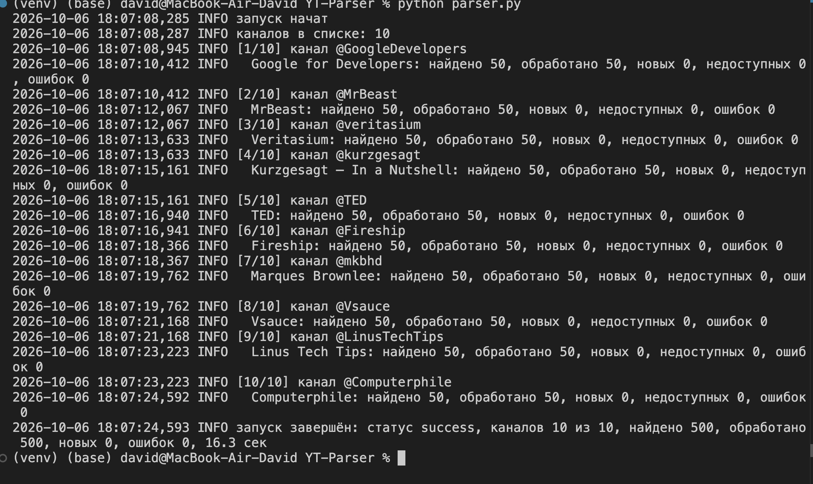
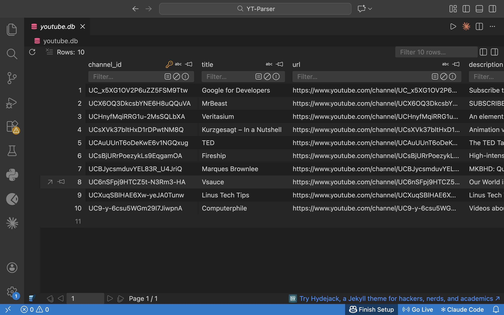
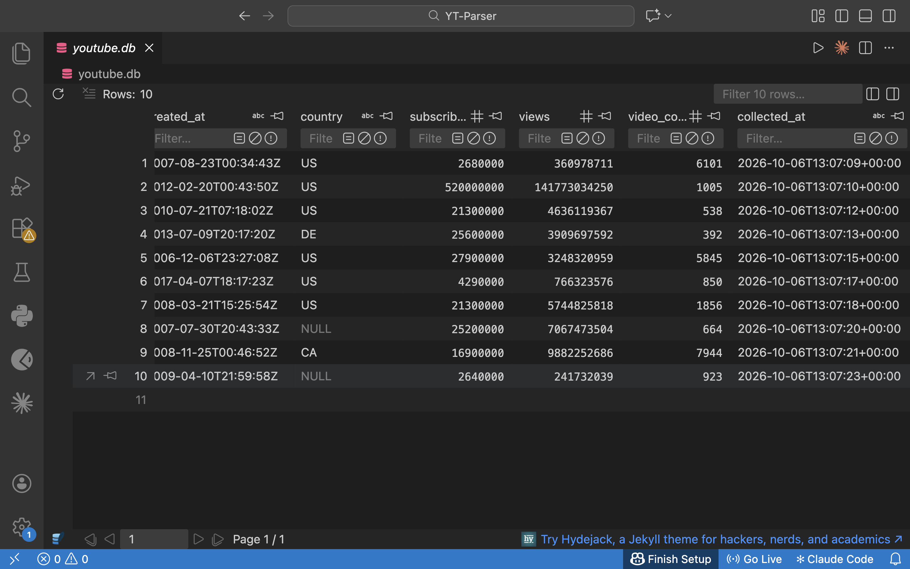
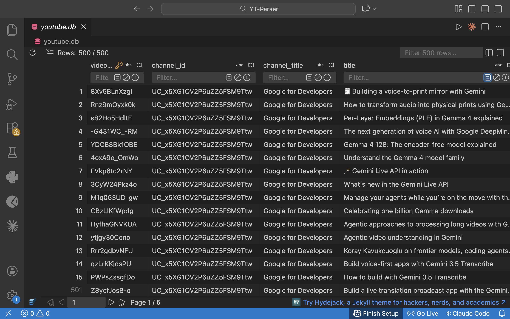
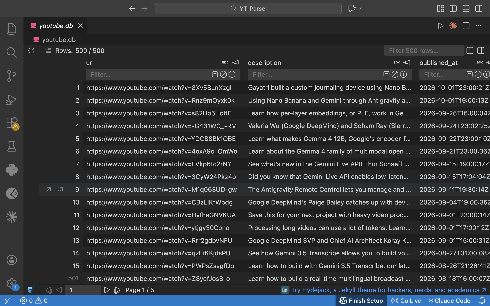
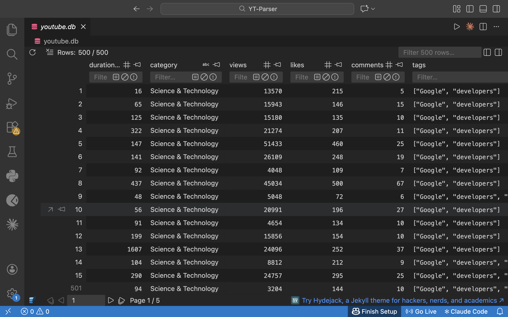
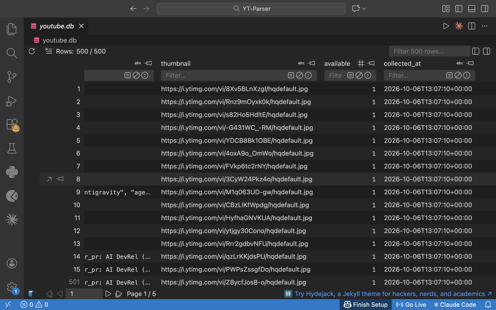
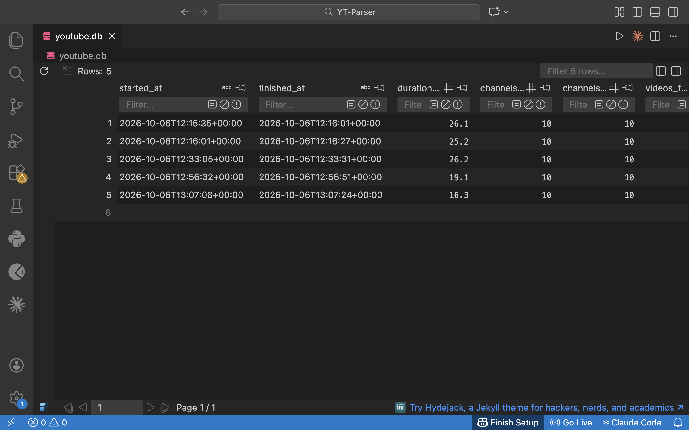
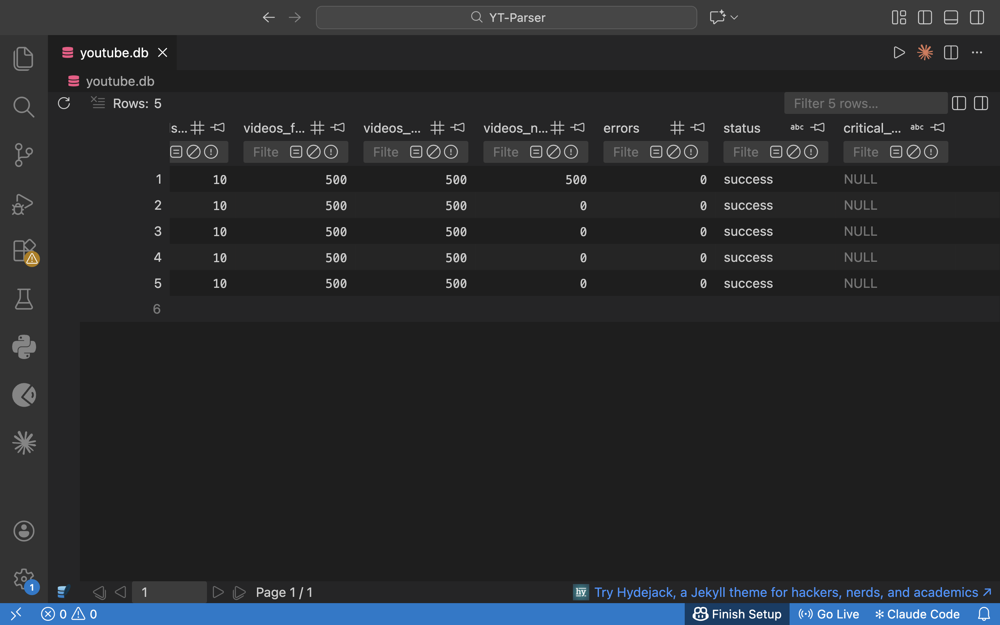

# YouTube Parser

Небольшой скрипт на Python. Он берёт список YouTube-каналов из текстового файла, через официальный
YouTube API собирает данные о самих каналах и об их видео и складывает всё в базу SQLite.

Запускать его можно сколько угодно раз: дубли не появляются. Новые видео добавляются, а у старых
обновляются просмотры, лайки и подписчики.

## Быстрый старт

Нужен Python 3.8 или новее (я проверял на версиях от 3.8 до 3.13) и свой ключ для YouTube API.
Как его получить, написано в [пункте 5](#5-как-получить-api-ключ).

```bash
git clone <адрес_репозитория>
cd <папка_репозитория>

python3 -m venv venv
source venv/bin/activate          # на Windows: venv\Scripts\activate
pip install -r requirements.txt

cp api.env.example api.env        # на Windows: copy api.env.example api.env
# откройте api.env и впишите свой ключ после YOUTUBE_API_KEY=

python parser.py
```

Скрипт работает 15–30 секунд, потом пишет итог. Данные лежат в `youtube.db`, журнал в `parser.log`.

Чтобы посмотреть, что получилось:

```bash
sqlite3 -header -column youtube.db "SELECT channel_title, title, views FROM videos ORDER BY views DESC LIMIT 5;"
sqlite3 -header -column youtube.db "SELECT * FROM runs;"
```

## Как это выглядит

Так выглядит запуск в терминале. Скрипт по очереди проходит все каналы и в конце пишет итог.



А так выглядит база после запуска (открыта в расширении SQLite Viewer для VS Code).

Каналы. У Vsauce и Computerphile в YouTube не указана страна, поэтому там `NULL`. Скрипт на это не обращает внимания.




Видео. Всего 500 штук, по 50 с каждого канала. Таблица широкая, поэтому на скриншотах она в четырёх частях.






Запуски. Один запуск, одна строка. В первой строке 500 новых видео, дальше новых нет, обновилась только статистика.




Если нет возможности запустить скрипт, в папке [examples](examples) лежит результат настоящего запуска:
журнал и выгрузка каналов, видео и запусков в CSV.

## 1. Что это и как устроено

```
channels.txt  ->  parser.py  ->  YouTube API  ->  youtube.db (данные)
(список)         (скрипт)                         parser.log (журнал)
```

За один запуск скрипт делает вот что:
1. Читает каналы из `channels.txt`.
2. Для каждого канала запрашивает его данные и сохраняет их.
3. Сам находит последние видео канала. Вводить ID видео вручную не нужно.
4. Запрашивает данные и статистику этих видео, а также тех, что уже есть в базе.
5. Сохраняет всё в базу и дописывает статистику за сегодня, чтобы потом можно было смотреть, как она менялась.
6. Записывает итоги в журнал и в таблицу `runs`.

Весь код лежит в одном файле `parser.py`. Внутри он поделён на понятные куски: настройки, запросы к API, база, обработка канала, запуск.

## 2. Что использовано

Python 3, база SQLite (она уже встроена в Python) и две библиотеки: `requests` для запросов и `python-dotenv`, чтобы читать ключ из файла.

## 3. Что где лежит

```
parser.py          сам скрипт
channels.txt       список каналов
requirements.txt   нужные библиотеки
api.env.example    образец файла с ключом
crontab.example    пример расписания для cron
examples/          пример результата: журнал и CSV
docs/              скриншоты для этого README
api.env            ваш ключ (создаёте сами, в git не попадает)
youtube.db         база (появляется после первого запуска)
parser.log         журнал (появляется после первого запуска)
```

## 4. Какие методы YouTube API используются

| Метод | Для чего | Квота |
|---|---|---|
| `channels.list` | данные канала; по `@имени` находит ID канала; отдаёт адрес списка всех его загрузок | 1 |
| `playlistItems.list` | ID последних видео канала | 1 |
| `videos.list` | данные и статистика видео, до 50 штук за один запрос | 1 |
| `videoCategories.list` | названия категорий | 1 |

Обычный поиск (`search.list`) я не использую. Он стоит 100 единиц квоты, а список загрузок всего 1.

## 5. Как получить API-ключ

1. Зайдите в [Google Cloud Console](https://console.cloud.google.com/) и создайте проект.
2. Откройте *APIs & Services → Library*, найдите **YouTube Data API v3** и нажмите **Enable**.
3. Откройте *APIs & Services → Credentials*, нажмите *Create credentials → API key*.
4. В настройках ключа в разделе *API restrictions* выберите *Restrict key* и отметьте только YouTube Data API v3.
   Ограничения по приложению (*Application restrictions*) можно не ставить.
5. Скопируйте `api.env.example` в `api.env` и впишите туда ключ:

```
YOUTUBE_API_KEY=ваш_ключ
```

Файл `api.env` закрыт в `.gitignore`, так что в репозиторий он не попадёт. Не выкладывайте ключ и никому его не пересылайте.
Если он всё-таки утёк, удалите его в консоли Google и создайте новый.

## 6. Установка зависимостей

Всё то же, что в [быстром старте](#быстрый-старт): создать `venv` и выполнить `pip install -r requirements.txt`.

## 7. Настройки

Ключ лежит в `api.env`, каналы в `channels.txt`. Остальные настройки это несколько констант в начале `parser.py`:

| Настройка | Сейчас | Что делает |
|---|---|---|
| `MAX_VIDEOS_PER_CHANNEL` | 50 | сколько последних видео канала проверять на новые |
| `TIMEOUT` | 15 | сколько секунд ждать ответ от YouTube |
| `RETRIES` | 3 | сколько раз пробовать, если запрос не прошёл |

## 8. Где хранятся данные

Я выбрал **SQLite**. Это один файл, ничего не нужно ставить и настраивать, а данные удобно разбирать
обычными SQL-запросами. Для десятков каналов этого хватает с запасом. Если каналов станет сильно больше,
базу можно заменить на PostgreSQL (об этом в [пункте 16](#16-как-масштабировать-до-500-1000-каналов)).

| Таблица | Что в ней |
|---|---|
| `channels` | текущие данные каналов |
| `videos` | текущие данные видео; если `available = 0`, видео удалили или закрыли |
| `channel_stats_history` | подписчики, просмотры и число видео: по строке на канал в день |
| `video_stats_history` | просмотры, лайки и комментарии: по строке на видео в день |
| `runs` | итоги каждого запуска |

Поля в `channels` и `videos` такие, как просит ТЗ. Теги хранятся списком в формате JSON, длительность в секундах (`duration_sec`).
Если значения нет (страна, теги, лайки), в базе будет `NULL`.

Примеры запросов:

```sql
-- самые популярные видео
SELECT channel_title, title, views FROM videos ORDER BY views DESC LIMIT 10;

-- как менялось число подписчиков
SELECT c.title, h.date, h.subscribers
FROM channel_stats_history h JOIN channels c USING (channel_id)
ORDER BY c.title, h.date;

-- что было в последних запусках
SELECT started_at, status, videos_found, videos_processed, videos_new, errors FROM runs;
```

Базу можно открыть командой `sqlite3 -header -column youtube.db`, в DataGrip (источник данных SQLite, файл `youtube.db`)
или в VS Code с расширением SQLite Viewer.

## 9. Как запустить вручную

```bash
source venv/bin/activate
python parser.py
```

Если всё прошло хорошо, скрипт завершается с кодом `0`. Если были ошибки, с кодом `1`.

## 10. Как настроить запуск по расписанию

### cron (Linux и macOS)

```bash
crontab -e
```

Добавьте строку, подставив свой путь. Эта запускает скрипт каждый день в 03:00:

```
0 3 * * * cd /opt/youtube-parser && ./venv/bin/python parser.py >> cron.log 2>&1
```

Такой же пример лежит в `crontab.example`. На ноутбуке cron не сработает, если компьютер спит.

### systemd timer (Linux)

Файл `/etc/systemd/system/youtube-parser.service`:

```ini
[Unit]
Description=YouTube Parser

[Service]
Type=oneshot
WorkingDirectory=/opt/youtube-parser
ExecStart=/opt/youtube-parser/venv/bin/python parser.py
```

Файл `/etc/systemd/system/youtube-parser.timer`:

```ini
[Unit]
Description=Daily YouTube Parser

[Timer]
OnCalendar=*-*-* 03:00:00
Persistent=true

[Install]
WantedBy=timers.target
```

Включить таймер: `sudo systemctl daemon-reload && sudo systemctl enable --now youtube-parser.timer`.
Проверить, что он работает: `systemctl list-timers | grep youtube`, а логи смотреть через `journalctl -u youtube-parser`.

## 11. Как добавить или убрать канал

Откройте `channels.txt`. Один канал на строку. Можно писать `@имя` (как в адресе `youtube.com/@имя`) или ID канала вида `UCxxxx`.
Всё, что после `#`, скрипт пропускает.

- Чтобы добавить канал, допишите строку и сохраните файл.
- Чтобы убрать, удалите строку или поставьте перед ней `#`.

Код трогать не нужно. Данные убранного канала остаются в базе.

## 12. Журнал и ошибки

Журнал выводится на экран и пишется в файл `parser.log`. Когда файл вырастает до 1 МБ, он начинает писаться заново,
а три предыдущих копии сохраняются. В журнале видно: когда запуск начался и закончился, сколько каналов, какой канал обрабатывается сейчас (`[3/10]`),
сколько видео найдено, обработано и новых, сколько ошибок, что за критические ошибки были, сколько всё заняло и чем закончилось.
То же самое, коротко, попадает в таблицу `runs`.

```bash
tail -n 50 parser.log                 # последние записи
grep -E "ERROR|CRITICAL" parser.log   # только ошибки
```

Чем может закончиться запуск: `success` (всё хорошо), `partial` (что-то собрали, но были ошибки или запуск остановился),
`failed` (ни один канал не удалось обработать).

Что чаще всего идёт не так:

| В журнале | Что случилось и что делать |
|---|---|
| `в api.env нет YOUTUBE_API_KEY` | нет файла `api.env` или в нём нет строки с ключом |
| `HTTP 403 ... accessNotConfigured` | в проекте Google не включён YouTube Data API v3 |
| `HTTP 400 ... keyInvalid` | ключ неправильный, или в его ограничениях нет YouTube Data API v3 |
| `закончилась квота YouTube API` | на сегодня лимит выбран; всё, что успели собрать, сохранено, повторите завтра |
| `канал не найден` | опечатка в `channels.txt`; остальные каналы обработались нормально |
| `сетевая ошибка` | нет интернета или у YouTube сбой; скрипт уже пробовал три раза |

## 13. Что будет при повторном запуске

- Новые видео находятся и добавляются в базу.
- У каналов и у всех видео, которые уже есть в базе, обновляются цифры (подписчики, просмотры, лайки, комментарии).
  Даже если видео давно вышло и не входит в последние 50.
- Дублей не будет. Запись определяется по ID канала или видео и просто обновляется.
- Статистика за новый день добавляется в таблицы истории. Если запустить скрипт дважды за день, сегодняшняя строка перезапишется.
- Если видео удалили или закрыли, оно получит `available = 0`, остальные данные о нём останутся.
- Новые видео ищутся среди последних `MAX_VIDEOS_PER_CHANNEL`. Если между запусками вышло больше видео, чем это число, лишние
  подтянутся не сразу. Поэтому не стоит запускать скрипт слишком редко.

## 14. Ограничения YouTube API и квота

- Обычно даётся 10 000 единиц квоты в день на проект. Она обнуляется около полуночи по тихоокеанскому времени.
- Все методы, которые мы используем, стоят по 1 единице за запрос.
- Один запуск на 10 каналов тратит около 40 единиц: по 3 запроса на канал, один на категории и по одному на каждые 50 видео из базы.
  Так что запускать можно много раз в день.
- Если квота закончилась, скрипт останавливается, пишет об этом в журнал и сохраняет всё, что успел собрать.
- Лайки, комментарии, теги и страна иногда недоступны, например автор их скрыл. Тогда в базе будет `NULL`.

## 15. Как развернуть на Linux-сервере

Эти шаги и systemd-таймер из пункта 10 я проверил на Ubuntu 24.04 (в Docker, с Python 3.12).

```bash
# 1. Ставим нужное (Debian/Ubuntu)
sudo apt update && sudo apt install -y python3 python3-venv git

# 2. Забираем код
sudo mkdir -p /opt/youtube-parser && sudo chown $USER /opt/youtube-parser
git clone <адрес_репозитория> /opt/youtube-parser
cd /opt/youtube-parser

# 3. Ставим зависимости
python3 -m venv venv
./venv/bin/pip install -r requirements.txt

# 4. Кладём ключ (читать файл сможет только владелец)
cp api.env.example api.env
nano api.env
chmod 600 api.env

# 5. Пробный запуск
./venv/bin/python parser.py

# 6. Настраиваем расписание: cron или systemd timer, см. пункт 10
```

`youtube.db` и `parser.log` появятся в той же папке. Чтобы сделать резервную копию, достаточно скопировать `youtube.db`.

## 16. Как масштабировать до 500-1000 каналов

Для 10 каналов скрипт специально сделан простым. Если каналов станет 500-1000, понадобится вот что:

1. **Квота.** На один канал уходит около 3 единиц. На 1000 каналов это 3000 единиц за запуск, и три запуска в день уже упираются в лимит.
   Что можно сделать: обновлять старые видео не каждый запуск, а раз в день или реже; искать новые видео только до первого уже известного;
   попросить у Google больше квоты.
2. **Запросы пачками.** `channels.list` умеет отдавать до 50 каналов за один запрос, если указать их ID. Достаточно хранить в списке ID вместо `@имён`,
   и запросов на данные каналов станет в десятки раз меньше.
3. **База.** Перейти на PostgreSQL: записей будет больше, и анализировать их удобнее. Нужно заменить `init_db`, `save_channel`, `save_video`, `save_run`
   и подключение к базе, остальной код менять не придётся.
4. **Время.** Сейчас каналы идут по очереди, и 1000 каналов займут около 40 минут. Список можно разбить на части и запускать их в разное время
   или в нескольких процессах.
5. **Код.** Разнести `parser.py` на несколько файлов (запросы к API, база, запуск) и добавить автотесты.
6. **Уведомления.** Присылать сообщение на почту или в Telegram, если запуск закончился не `success`.
